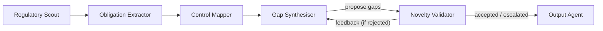

# RegRadar - Multi-Agent Regulatory Change Radar

RegRadar turns new regulatory circulars into **validated, prioritised compliance gaps**. Six LangGraph agents retrieve regulations, extract obligations, map them to internal controls, propose gaps, independently validate them in an **adaptive feedback loop**, and write a remediation report. A FastAPI backend serves a React + TypeScript dashboard.

> The demo uses a **synthetic** dataset (RBI/MeitY-style circulars) and a fictional company, *Acme Pay*. In demo mode the LLM is replaced by a **deterministic demo responder**; the LangGraph graph, routing, validator checks and trace are real. Every demo output is labelled as such.

---

## Highlights

* **Six LangGraph Agents:** Regulatory Scout &rarr; Obligation Extractor &rarr; Control Mapper &rarr; Gap Synthesiser &harr; Novelty Validator &rarr; Output Agent.
* **Adaptive Feedback Loop:** The Novelty Validator rejects gaps with structured feedback (issue code, target field, expected value). The Gap Synthesiser receives this through shared LangGraph state and revises, withdraws, or defends each gap. The graph re-validates, finalising accepted gaps or escalating to a human compliance officer upon reaching the revision limit.
* **Nine Independent Validation Checks:** Evidence grounding, citation consistency, already covered, already tracked (novelty / known-issues register), duplicate detection, modality classification, severity calibration, required detail, and obligation existence.
* **Persistent Execution Traces:** Full chronological record of every message passed between agents, inspectable in the web dashboard.
* **Live Mode:** Anthropic or any OpenAI-compatible provider (OpenAI, Groq, Google Gemini, Ollama), pasted circulars, and live RBI/SEBI RSS feeds.
* **Automated Test Suite:** Comprehensive test suite covering unit logic, validation rules, feedback-loop cycles, API endpoints, and source retrieval.
* **Single-Project Cloud Deployment:** Built for simple deployment to Vercel with FastAPI serverless backend and Vite React dashboard.

---

## Architecture & Feedback Loop

### The Six Agents



1. **Regulatory Scout:** Ingests circulars from synthetic demo datasets, manual user uploads/pastes, or live RBI/SEBI RSS feeds.
2. **Obligation Extractor:** Parses regulatory text into atomic, actionable compliance obligations with exact citations, quotes, and deadlines.
3. **Control Mapper:** Matches extracted obligations against Acme Pay's internal control library (`data/controls/control_library.json`) and flags covered vs uncovered requirements.
4. **Gap Synthesiser:** Proposes remediation gaps for missing or partially covered obligations, assigning priority, owner, target remediation date, and impact analysis.
5. **Novelty Validator:** Acts as an independent quality auditor. Evaluates proposed gaps across 9 deterministic checks. Rejections return structured feedback to the Synthesiser.
6. **Output Agent:** Consolidates accepted gaps, escalated items, and coverage statistics into a comprehensive remediation plan and executive summary.

### 9 Validation Checks

| Check | Description |
|---|---|
| **Obligation Exists** | Verifies the referenced obligation ID is present in extracted obligations. |
| **Citation Consistency** | Ensures section/paragraph citation accurately matches the obligation's source citation. |
| **Evidence Grounding** | Verifies evidence quotes exist verbatim in the source regulatory text. |
| **Not Already Covered** | Prevents proposing a gap for obligations that an internal control already fully satisfies. |
| **Not Already Tracked** | Cross-references known-issues register to prevent re-logging existing audit findings. |
| **Not Duplicate** | Deduplicates overlapping gap proposals within the current run. |
| **Mandatory Classification** | Ensures non-binding recommendations are not escalated as mandatory breaches. |
| **Severity Calibration** | Checks that high/critical severity matches strict criteria (e.g. strict deadlines, heavy penalties). |
| **Required Detail** | Enforces actionable remediation steps and assigned departmental owners. |

---

## Quick Start (Local Development)

### Prerequisites
* Python 3.11+
* Node.js 18+ and npm

### 1. Backend Setup

```powershell
# From the project root
py -m venv .venv
.\.venv\Scripts\Activate.ps1
python -m pip install --upgrade pip
python -m pip install -r requirements-dev.txt
python -m pip check

# Copy environment template (optional for demo mode)
Copy-Item .env.example .env

# Run FastAPI server
python -m uvicorn backend.main:app --reload --host 127.0.0.1 --port 8000
```

### 2. Frontend Setup

```powershell
# In a new terminal
cd frontend
npm install
npm run dev
```

* **Dashboard:** <http://localhost:5173>
* **API Health:** <http://127.0.0.1:8000/api/health>
* **Interactive API Docs (Swagger):** <http://127.0.0.1:8000/docs>

### CLI Run (without UI)

```powershell
# Run deterministic demo directly in CLI
python -m backend.cli demo --report
```

---

## Environment Variables

Settings are read from process environment variables and `.env` in the project root. **None are required for the deterministic demo.**

### Configuration Reference

| Variable | Default | Purpose |
|---|---|---|
| `APP_ENV` | `development` | Environment label (`development` or `production`) |
| `LOG_LEVEL` | `INFO` | Python logging level (`DEBUG`, `INFO`, `WARNING`, `ERROR`) |
| `DATABASE_URL` | `sqlite:///./data/regradar.db` | Storage path: SQLite (`sqlite:///path`) or PostgreSQL (`postgresql://...`) |
| `CORS_ORIGINS` | `http://localhost:5173,http://127.0.0.1:5173` | Allowed browser origins |
| `LLM_PROVIDER` | `openai` | LLM backend: `demo`, `openai` (works with Groq, Gemini, OpenAI, Ollama), or `anthropic` |
| `LLM_MODEL` | `openai/gpt-oss-120b` | Model name for live LLM mode |
| `LLM_TEMPERATURE` | `0.1` | Sampling temperature |
| `LLM_TIMEOUT_SECONDS` | `60` | HTTP timeout per LLM request (5–600) |
| `LLM_MAX_RETRIES` | `2` | Number of automatic retries on rate limits or errors |
| `OPENAI_API_KEY` | *(configured in .env)* | API key for OpenAI-compatible provider (Groq, OpenAI, Gemini) |
| `OPENAI_BASE_URL` | `https://api.groq.com/openai/v1` | Base URL for OpenAI-compatible endpoint |
| `ANTHROPIC_API_KEY` | *(optional)* | Anthropic API key (`sk-ant-...`) if `LLM_PROVIDER=anthropic` |
| `ANTHROPIC_BASE_URL` | `https://api.anthropic.com` | Base URL for Anthropic |
| `MAX_REVISIONS` | `2` | Maximum Gap Synthesiser &harr; Novelty Validator feedback loops (0–5) |
| `LIVE_SOURCES_ENABLED` | `true` | Enable fetching live RBI & SEBI RSS feeds |
| `SOURCE_TIMEOUT_SECONDS`| `15` | Timeout for fetching public feeds |
| `RBI_RSS_URL` | `https://www.rbi.org.in/notifications_rss.xml` | Public RSS feed for RBI circulars |
| `SEBI_RSS_URL` | `https://www.sebi.gov.in/sebirss.xml` | Public RSS feed for SEBI circulars |
| `SERVE_FRONTEND` | `true` | Have FastAPI serve `frontend/dist` when present |
| `FRONTEND_DIR` | `frontend/dist` | Path to pre-built frontend distribution |
| `SLACK_WEBHOOK_URL` | *(optional)* | Incoming webhook URL for Slack run completion alerts |
| `N8N_WEBHOOK_URL` | *(optional)* | Webhook URL for n8n automated workflow trigger |

---

## Deploy to Vercel

The application is structured for seamless single-project deployment on Vercel:

1. **Push to GitHub:** Push this repository to your GitHub account.
2. **Import in Vercel:**
   * Go to Vercel &rarr; **Add New > Project**.
   * Import the repository with root directory `./`.
   * Vercel will detect FastAPI and Vite. `vercel.json` configures the backend serverless function and frontend routing.
3. **Database (Optional for Persistent Storage):**
   * Under project **Storage**, create a **Neon PostgreSQL** database. Vercel automatically injects `DATABASE_URL`.
   * If unset, a temporary SQLite database in `/tmp` is used automatically.
4. **Environment Variables:**
   * Add `OPENAI_API_KEY`, `LLM_PROVIDER`, etc. in Vercel **Settings > Environment Variables** if overriding defaults.
5. **Deploy:** Trigger deployment. Access your live dashboard at `https://<your-project>.vercel.app`.

---

## Automated Tests & Verification

Run the full verification suite using Windows PowerShell:

```powershell
powershell -ExecutionPolicy Bypass -File scripts\verify.ps1
```

Or run individual test suites:

```powershell
# Run all backend tests
python -m pytest

# Run feedback-loop validation tests
python -m pytest tests/test_feedback_loop.py -v

# Run linter
.venv\Scripts\python.exe -m ruff check backend tests

# Frontend checks
cd frontend
npm run lint
npm run typecheck
npm run build
```

---

## API Overview

| Method | Path | Purpose |
|---|---|---|
| `GET` | `/api/health` | Healthcheck and storage status |
| `GET` | `/api/config` | Public non-sensitive configuration |
| `GET` | `/api/agents` | Agent registry and system prompts |
| `GET` | `/api/graph` | Graph topology and node metadata |
| `GET` | `/api/sources/demo-dataset` | Synthetic circular dataset |
| `GET` | `/api/controls` | Acme Pay internal control library |
| `POST` | `/api/demo/run` | Execute deterministic demo through LangGraph |
| `POST` | `/api/runs` | Trigger a new compliance analysis |
| `GET` | `/api/runs` | List analysis history |
| `GET` | `/api/runs/{id}` | Detailed status of a run |
| `GET` | `/api/runs/{id}/trace` | Full execution trace between agents |
| `GET` | `/api/runs/{id}/report` | Final compliance report (JSON or Markdown) |
| `DELETE` | `/api/runs/{id}` | Delete a run and its trace |
| `POST` | `/api/integrations/test` | Test Slack and n8n webhook notifications |

---

## Project Structure

```
backend/
  main.py              # FastAPI application entry point
  api/routes.py        # REST API endpoints
  agents/              # Six agents + shared policy rules + registry
  orchestration/       # LangGraph state, cyclic graph, runner
  llm/                 # Demo responder, OpenAI/Groq/Anthropic clients
  retrieval/           # Knowledge base, RSS parsers, text extraction
  integrations/        # Slack and n8n webhooks
  db.py                # Database connection & persistence (SQLite / Postgres)
  config.py            # Settings loader & environment variables
  schemas.py           # Pydantic data models
  cli.py               # CLI interface
data/
  controls/            # Acme Pay control library & known-issues register
  demo/                # Labelled synthetic regulatory circulars
frontend/              # React + TypeScript + Vite dashboard
tests/                 # Pytest test suite (unit, feedback-loop, API)
n8n/                   # n8n scheduled workflow definition
scripts/
  verify.ps1           # Complete end-to-end test and build verification
standalone_examples/   # Standalone CLI tools and sample payloads
Dockerfile             # Backend container definition
docker-compose.yml     # Multi-container orchestration (backend + frontend + n8n)
vercel.json            # Vercel deployment routing and configuration
requirements.txt       # Production dependencies
requirements-dev.txt   # Development & test dependencies
```

---

## Limitations

* **Prototype Scope:** Designed as an academic compliance decision-support prototype; findings must be reviewed by qualified compliance professionals.
* **Control Mapping:** Uses hybrid keyword and lexical matching against Acme Pay's internal control library.
* **Authentication:** Single-tenant prototype without multi-user authentication.
